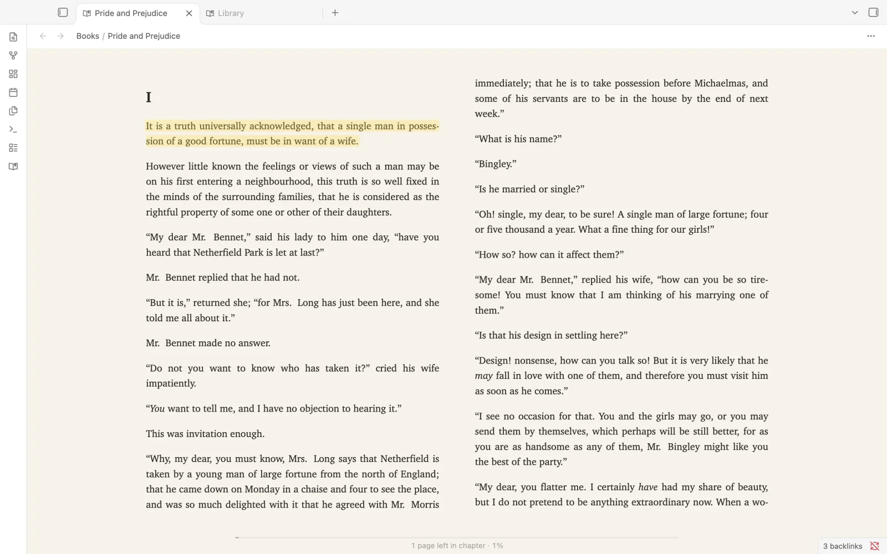
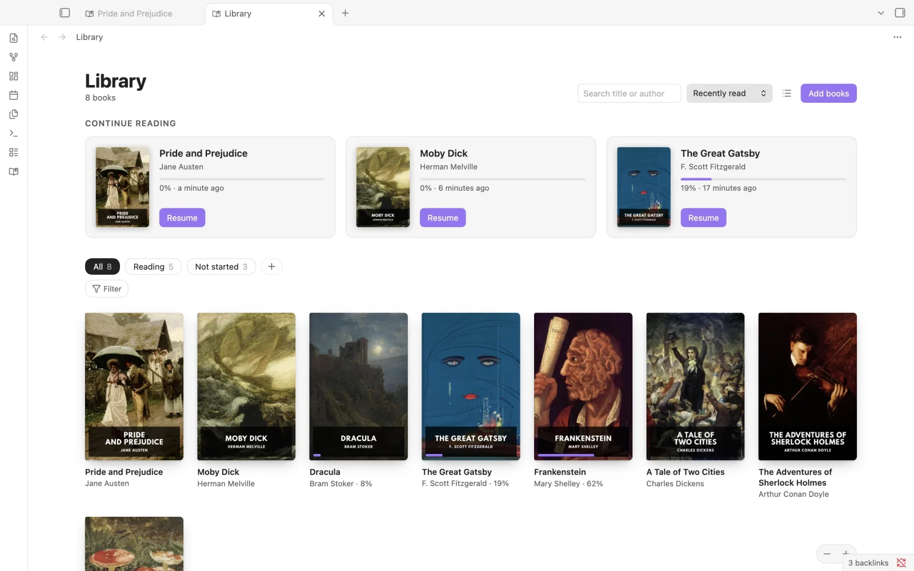
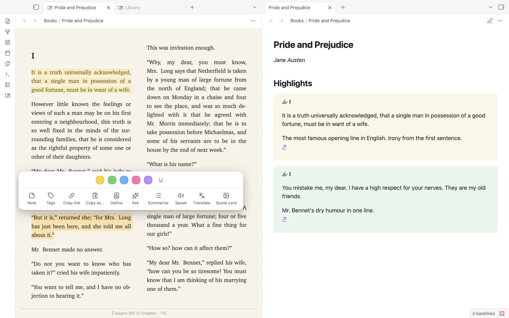
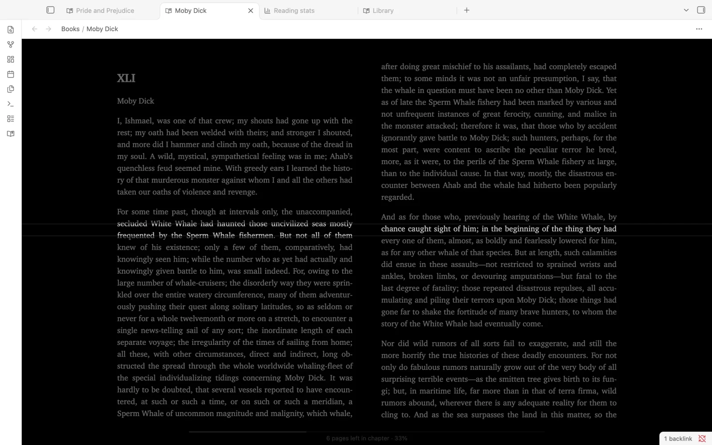
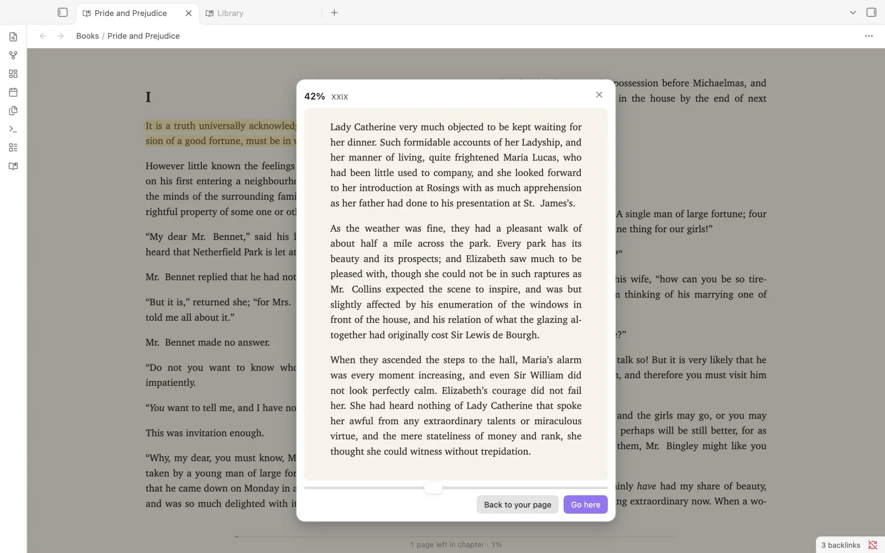
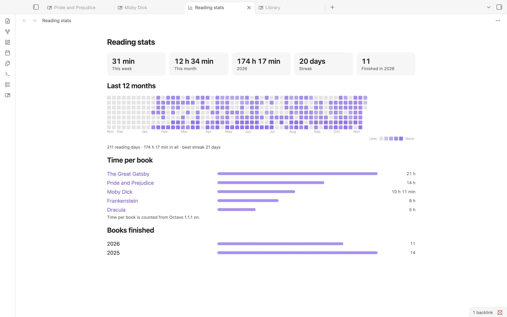
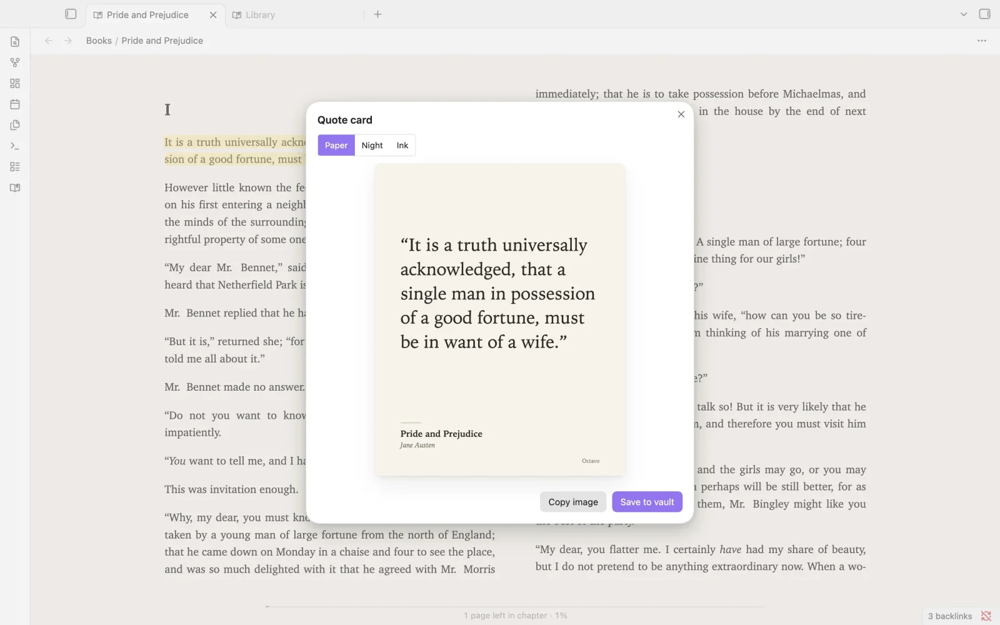
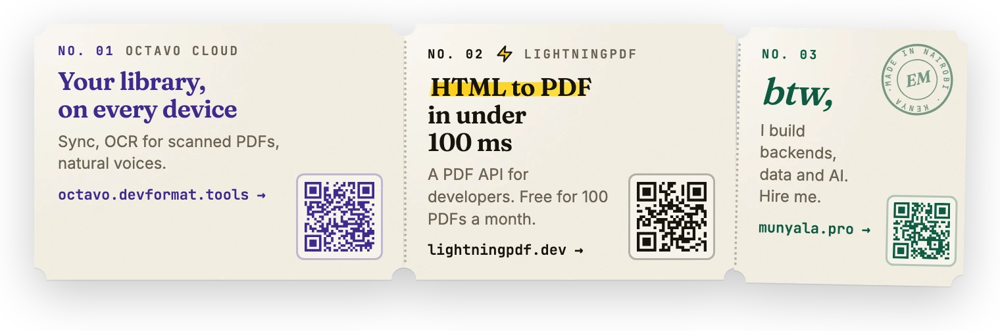

# Octavo

**Read EPUB and PDF books in Obsidian, with highlights that live in your vault as linked Markdown.**



Octavo is a calm, full-featured book reader for Obsidian on desktop, iPhone, iPad and Android. Every reader feature is free.

### Your library, built on your notes

Covers, Continue Reading, shelves and collections. Each book is a Markdown note, so it works with Bases and search.



### Highlights become notes

Select text, pick a colour, add a note. It lands in the book's note as Markdown, with a link back to the exact passage. Define, translate, read aloud or make a quote card from the same menu.



### Made for long reading

A reading ruler that follows your eye (four styles from a 2023 study with readers with dyslexia), True Black and six other themes, a dimmer, footnote pop ups and a screen that stays awake.



### Flip through without losing your place

Drag through the book to look ahead, then go back to your page or jump there.



### See your reading

A year of reading days, streaks, time per book and books finished, all kept in your vault.



### Share a line

Turn any passage into a quote card in Paper, Night or Ink, then copy it or save it to your vault.



### Everything else

- **EPUB, PDF, MOBI, AZW3, FB2 and CBZ**: themes, fonts and spacing, page turns, two page spreads, line width and a full screen focus mode.
- **Your notes in the margins.** Any note that links into a book shows up in the text. Hover over it to preview.
- **PDF++ links keep working.** Importers bring in highlights from Annotator, Weave, Elton, Kindle, KOReader, Readest and others.
- **Study tools**: search with whole word and match case options, daily highlights in your daily note, a "story so far" recap when you come back to a book, and a vocabulary list from Define.
- **Read aloud** with your system voices, plus optional AI (your own API key or a local model through Ollama).
- **Goals and streaks** if you want them, logged to your daily note. Nothing leaves your device.
- **Page turner keys and remotes**, double tap to define, and text size remembered per book.

Website: https://octavo.devformat.tools

## Install

In Obsidian, go to **Settings → Community plugins → Browse**, search for **Octavo**, then select **Install** and **Enable**.


## Moving from PDF++ or Annotator

- **PDF++ links keep working.** `[[book.pdf#page=12&selection=…&color=…]]` and region embeds (`#page=…&rect=…`) open in Octavo at the same place, and highlights are drawn back onto the page.
- **Annotator highlights** come across with *Import highlights → Annotator* (colours and comments included).
- **Make Octavo your PDF viewer:** Settings → Octavo Reader → Library → "Open PDFs in Octavo". Your PDF files are never modified.
- **What differs:** Octavo stores highlights in the book's Markdown note (one callout per highlight) instead of inside the PDF, and adds a library, read aloud, phone layouts and EPUB in the same reader.

Full guide: https://octavo.devformat.tools/moving-from-pdfplusplus.html

## On mobile (iPhone, iPad, Android)

Obsidian keeps plugin icons in the **ribbon menu**: tap the **Menu** button at the bottom right. To show Octavo
there, open Settings → Appearance → Ribbon menu → Manage and turn on "Octavo library". You can also run
**"Octavo Reader: Open library"** from the command palette, or simply tap any EPUB or PDF in your files.

## Beta testing

Want new builds before everyone else? Install the **BRAT** plugin, choose "Add beta plugin" and enter
`meaLuda/OctavoRelease`. Beta builds are marked as pre-releases and never reach directory installs.
If something looks wrong on your phone, run **"Octavo Reader: Copy mobile diagnostics"** and paste the report
into an issue.

## Octavo Cloud (optional)

The reader is free and works fully offline. **Octavo Cloud** is an optional paid subscription for hosted services that cost money to run:

- a cloud library that keeps books outside your vault
- Send-to-Octavo email inbox
- OCR for scanned PDFs
- natural neural voices
- KOReader progress sync
- hosted AI, on the Cloud + AI plan (coming soon)

**[See plans and prices](https://octavo.devformat.tools/#pricing)**. No free feature will ever be moved behind the paywall.

## More from the developer



[Octavo Cloud](https://octavo.devformat.tools/#pricing) · [LightningPDF](https://lightningpdf.dev), an HTML to PDF API · [munyala.pro](https://munyala.pro): I build backends, data platforms and AI.

## Disclosures

- **Payments.** Octavo Cloud features require a paid subscription. All reader features are free.
- **Account.** Octavo Cloud features need an Octavo account (email sign-in code, no password). The reader needs no account.
- **Network use.** Octavo makes network requests only when you use these features:
  - **Octavo Cloud** (`octavo.devformat.tools`): signing in, checking your plan, uploading and downloading cloud-library books, OCR and natural-voice jobs, and checkout.
  - **AI providers you configure yourself**: Anthropic, OpenAI or a local Ollama server, with your own key.
  - **Wiktionary** (`en.wiktionary.org`): when you use Define with no AI set up, only the word you selected is looked up.

  Nothing is sent in the background.
- **No telemetry.** Octavo collects no usage data.
- **One static ad, in Octavo's settings only.** The bottom of Octavo's settings tab shows three links with QR codes: Octavo Cloud, LightningPDF (the developer's PDF API) and the developer's site. They are bundled in the plugin: nothing is loaded from the internet, clicks are not tracked, and no ads appear anywhere else.
- **Local storage.** Covers, tables of contents and book caches are kept in Obsidian's per-device browser storage (IndexedDB) and are never synced. Your highlights, notes and progress are plain files in your vault.
- **Files outside the vault.** Octavo does not read or write files outside your vault.
- **Why it lists vault files.** The library finds your books by listing the vault's EPUB and PDF files, and links highlights to notes. File contents are only read for books you open.
- **Clipboard.** Only written when you choose a Copy action (for example "Copy link" on a highlight); Octavo never reads your clipboard.

Privacy policy: https://octavo.devformat.tools/privacy.html · Terms: https://octavo.devformat.tools/terms.html

## Support

Email **eliud@munyala.pro** or open an issue in this repository.

## Source and licence

Octavo is open source under the **GNU Affero General Public License v3.0 or later** ([LICENSE](LICENSE)).
Copyright © 2026 Munyala Eliud (MEA Tech). Third-party components and their licences are listed in
[THIRD-PARTY-NOTICES.md](THIRD-PARTY-NOTICES.md).

Octavo Cloud is a separate, optional hosted service that the plugin talks to over HTTPS; its server is not
part of this repository.

Build it yourself (Node 22+):

```
npm ci
npm test
npm run build        # → packages/plugin/dist/main.js, styles.css, manifest.json
```

Every release is built from this repository by GitHub Actions and carries a signed build attestation
(`gh attestation verify main.js --repo meaLuda/OctavoRelease`).
